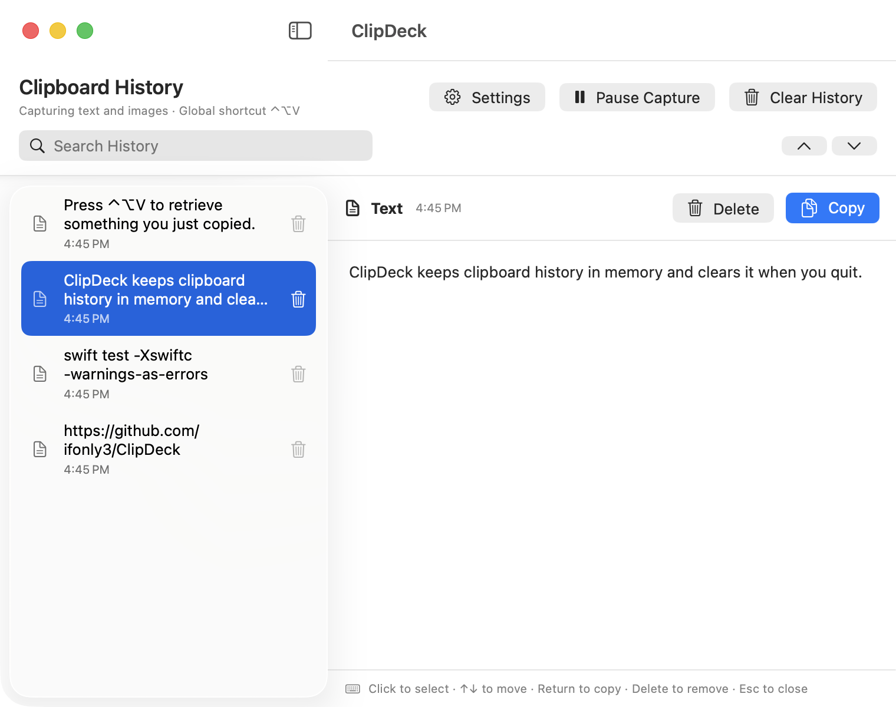
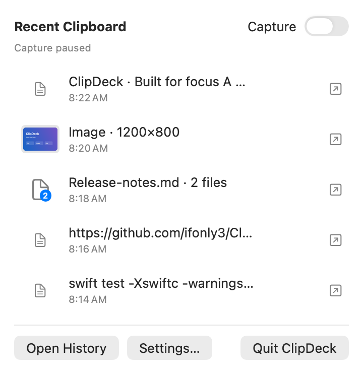
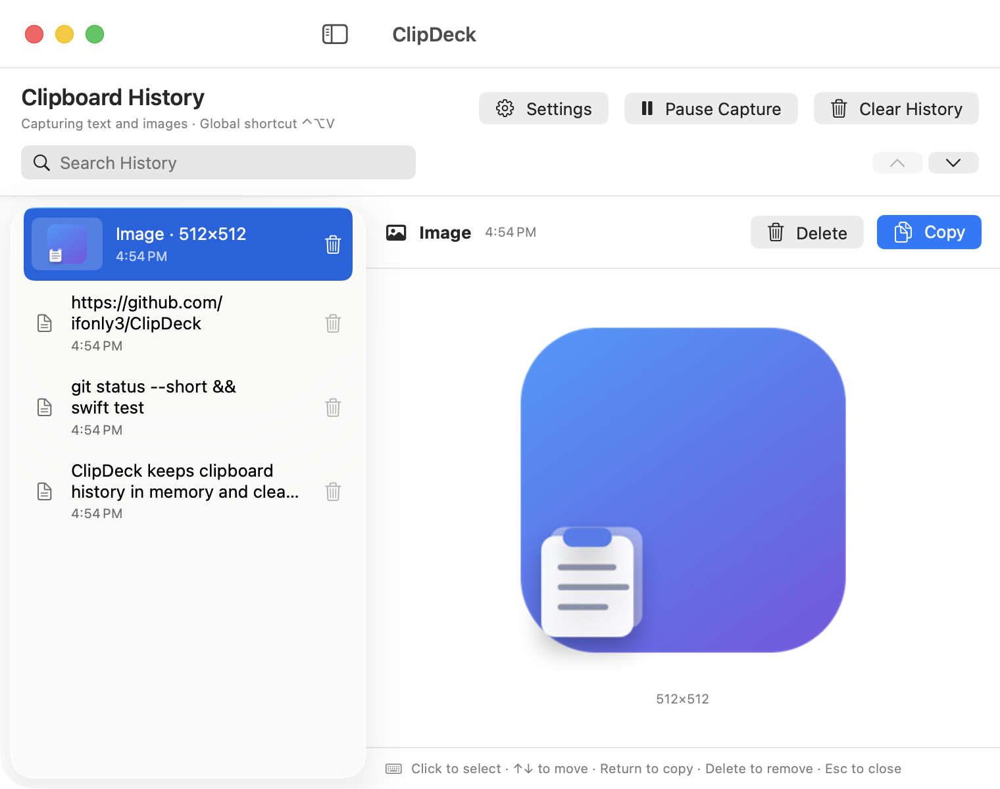
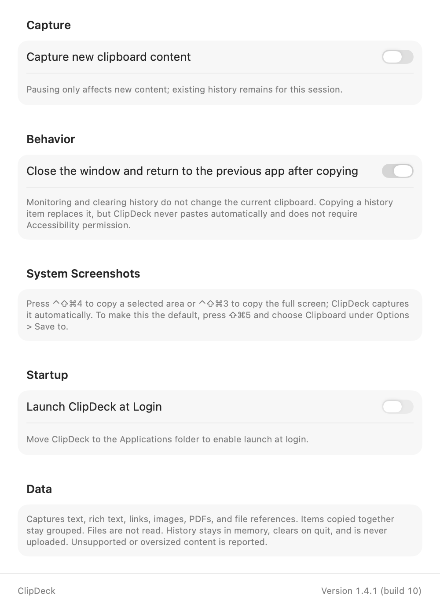

# ClipDeck

<p align="right"><a href="README.md">简体中文</a> · <strong>English</strong></p>

> A native, focused, and fast session-based clipboard history utility for macOS.

  [](https://github.com/ifonly3/ClipDeck/actions/workflows/ci.yml) 

ClipDeck is a **native, focused, and fast** clipboard history utility for macOS. Built with SwiftUI and AppKit, it uses no Electron shell or third-party runtime and stays focused on one job: bringing back recently copied text, images, and Finder file references.

<p align="center">
  
</p>

<p align="center">
  <strong>Copy → ⌃⌥V → Click or ↑ / ↓ → Return</strong><br>
  <sub>Choose items with either the pointer or keyboard, then optionally return to the previous app.</sub>
</p>

## Why ClipDeck

- **Native and lightweight:** SwiftUI + AppKit with negligible idle CPU usage.
- **Text, rich text, and links:** Preserves whitespace and available RTF, RTFD, HTML, and URL formats, with an explicit Copy as Plain Text action.
- **Images and PDFs:** Supports common PNG, JPEG, HEIC, GIF, and TIFF images. PDFs retain their original multi-page data with a first-page preview.
- **One copy, one history entry:** Items copied together stay grouped and are restored in their original order.
- **Finder files and folders:** Keeps a multi-file selection as one history item while storing references only—ClipDeck never reads or duplicates file contents.
- **Pointer and keyboard friendly:** Press `⌃⌥V`, click an item or move with `↑` / `↓`, then press `Return` to copy it.
- **Always available from the menu bar:** See the eight most recent entries; click to restore or use the details button to open the matching entry.
- **Session-level privacy:** History stays in memory and is cleared when ClipDeck quits. Nothing is written to disk or uploaded.
- **Predictable controls:** Pause capture, search, delete and undo individual items, confirm before clearing, and return to the previous app after copying.
- **Native launch at login:** Uses the macOS login-item API instead of a persistent LaunchAgent.
- **Bilingual interface:** Supports English and Simplified Chinese and follows the macOS system language automatically.

## Interface

<p align="center">
  
</p>

<table>
  <tr>
    <td width="60%" valign="top">
      
      <br><sub><strong>Image history:</strong> preview common image formats and inspect their dimensions before copying.</sub>
    </td>
    <td width="40%" valign="top">
      
      <br><sub><strong>Native settings:</strong> control capture, close-after-copy behavior, and launch at login.</sub>
    </td>
  </tr>
</table>

## Everyday uses

| Scenario | Recently copied content | What ClipDeck helps with |
| --- | --- | --- |
| Development | Commands, errors, code fragments, configuration values | Recover the right snippet without repeatedly switching back to a terminal or document. |
| Writing | Headlines, links, quotes, and draft alternatives | Keep the immediate context around and bring back the previous wording. |
| Image work | Screenshots, icons, and visual references | Preview the image and its dimensions before choosing it. |
| Finder organization | Files, folders, or a group of items | Keep their original references, then copy the group back to Finder later. |
| Cross-app work | Research, messages, and spreadsheet values | Copy several things across apps and retrieve each one when needed. |

For example, you might copy a test command, a branch name, and a configuration value in sequence:

```text
swift test -Xswiftc -warnings-as-errors
codex/clipboard-shortcuts
{"environment":"staging","region":"ap-east-1"}
```

Press `⌃⌥V`, click the item or choose it with the arrow keys, then press `Return`—there is no need to find the original source again.

> ClipDeck treats recent clipboard content as short-term memory for the current work session. It is not a password manager, permanent archive, or cross-device sync service.

## Install

### Download the DMG (Apple silicon)

[Download ClipDeck from the English website](https://clipdeck-macos.aild-pricing.workers.dev/en). The current build supports Apple silicon Macs (M series) running macOS 13 or later.

Open the downloaded DMG and drag ClipDeck into Applications. This community build is ad-hoc signed; it is not signed with an Apple Developer ID and has not been notarized by Apple. If macOS blocks the first launch, follow the website instructions, verify the SHA-256 checksum, and use **Open Anyway** only if you trust this project and its source code.

### Build from source

Requires macOS 13 or later plus Xcode Command Line Tools / Swift 6.

```bash
git clone https://github.com/ifonly3/ClipDeck.git
cd ClipDeck
./script/install_release.sh
```

The script builds a Release bundle, generates the application icon, applies an ad-hoc signature, verifies code integrity, installs `/Applications/ClipDeck.app`, and launches it.

## Use

1. Launch ClipDeck and copy text, images, or Finder files as usual.
2. Press `⌃⌥V`, or click the ClipDeck menu bar icon.
3. Search and click an item, or move through history with the arrow keys.
4. Press `Return` to copy the selected content back to the system clipboard.

Main-window shortcuts:

| Action | Shortcut |
| --- | --- |
| Show ClipDeck globally | `⌃⌥V` |
| Search | `⌘F` |
| Select with the pointer | Click any history item |
| Select previous / next | `↑` / `↓` |
| Copy selected content | `Return` |
| Delete selected content | `Delete` |
| Undo deletion | `⌘Z` |
| Close the window | `Esc` or `⌘W` |

Open Settings from the gear button in the main window or from the menu bar menu.

The main-window heading shows the current version; the Settings footer shows the full version and build number. Both read the installed app bundle rather than a hard-coded release label.

Native macOS screenshots can go straight into ClipDeck: press `⌃⇧⌘4` to copy a selected area or `⌃⇧⌘3` to copy the full screen. To make clipboard output the default, press `⇧⌘5`, then choose **Clipboard** under **Options > Save to**. ClipDeck only reads the resulting image; it never takes screenshots itself or silently changes the system screenshot preference.

## Privacy and data scope

Clipboard history exists only in the current process memory. Quitting, signing out, shutting down, or restarting clears it. ClipDeck does not serialize history to disk or upload it. Clearing ClipDeck history does not clear the current system clipboard.

Background capture only reads the system clipboard and never rewrites its current contents. The clipboard changes only when you explicitly choose a history item and copy it back so it can be pasted; ClipDeck never performs the paste itself.

ClipDeck does not try to decide whether content is sensitive. Any readable text, image, or file reference within the safety limits is recorded under the same rules. File history contains only URLs and names; ClipDeck never reads file contents. If an original is moved, deleted, or stored on a disconnected volume, restoring it shows a clear error without changing the current system clipboard. Ordinary preferences such as window position and close-after-copy behavior are stored with macOS `UserDefaults`; they never contain clipboard text, images, or file references.

Default limits:

- Up to 40 history items.
- Up to 50,000 UTF-8 bytes per text part, and 256 items or file references in one copied group.
- Up to 8 MiB per rich-text representation.
- Up to 32 MiB and 16 megapixels per image, with a maximum edge of 12,000 pixels; every captured image retains or receives a broadly compatible PNG/TIFF clipboard representation.
- A shared 128 MiB retained-data budget covers all history, original formats, and derived previews. This conservative accounting is not a process-wide memory ceiling.
- Deleted-item undo has a separate budget of 20 actions and 64 MiB; oldest actions are discarded when necessary. Clearing history also removes history-deletion undo, so cleared items cannot reappear through Undo.

Boundaries: Finder entries store references, not file backups. File promises (temporary files not yet exported by the source app), audio/video payloads, and app-private objects are not guaranteed to be restored. Available generic text or image representations may be saved with a partial-capture notice. HTML uses a local text preview without executing scripts or downloading resources; copying still preserves the original HTML format. Unsupported, oversized, failed, and partial captures are reported without silently rewriting the system clipboard.

## Performance design

- Observes clipboard changes with a low-frequency timer instead of busy polling.
- Keeps native pasteboard access on the main thread to avoid racing AppKit caches used by search fields and standard copy actions; image decoding, hashing, and preview generation run in a background actor.
- Preserves compressed source data and caches separate 320 px list thumbnails and detail previews up to 960 px, with consistent rotation and mirroring.
- Uses a bounded image queue so a burst of large images cannot block later text captures or exhaust memory.
- Caches searchable text, menu titles, and timestamp strings to reduce SwiftUI recomputation and idle wakeups.

Known limitation: a slow synchronous macOS clipboard provider can still briefly block the interface while returning its raw data; size limits can only be checked after that return. Background access to the same `NSPasteboard` caused an AppKit cache crash in concurrent stress tests, so that unsafe optimization is not included in this release.

## Development

Build and run a Debug app:

```bash
./script/build_and_run.sh
```

Build and test:

```bash
swift build -Xswiftc -warnings-as-errors
swift test -Xswiftc -warnings-as-errors
```

Optional diagnostics:

```bash
./script/build_and_run.sh --verify
./script/build_and_run.sh --debug
./script/build_and_run.sh --logs
./script/build_and_run.sh --telemetry
```

The debug workflow stops any existing ClipDeck instance, builds and verifies a temporary `.app`, then opens it through LaunchServices. The project intentionally prevents multiple instances; do not use `open -n`, which can stack duplicate windows with the same bundle identifier.

## Project structure

```text
Sources/ClipDeck/
├── App/          # SwiftUI scenes and application entry point
├── Models/       # Clipboard content models
├── Services/     # Image processing, hot key, login item, and window coordination
├── Stores/       # Clipboard capture, history, and memory budgets
├── Support/      # Shared helpers and extensions
└── Views/        # Main window, detail, menu bar, and Settings UI

Tests/            # Swift Testing regression tests
script/           # Build, packaging, signing, and installation scripts
```

## Contributing

Issues, feature suggestions, and pull requests are welcome. Before submitting code, run the full test suite and preserve ClipDeck's native, focused, and fast product direction.

## License

ClipDeck is open source under the [MIT License](LICENSE).
