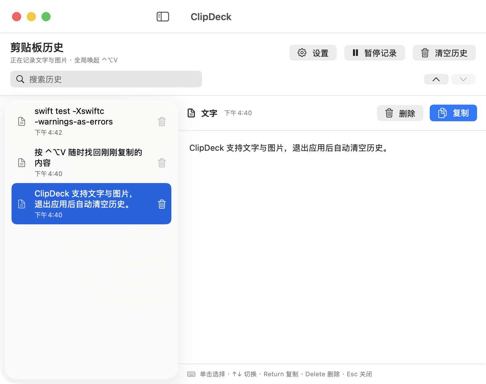
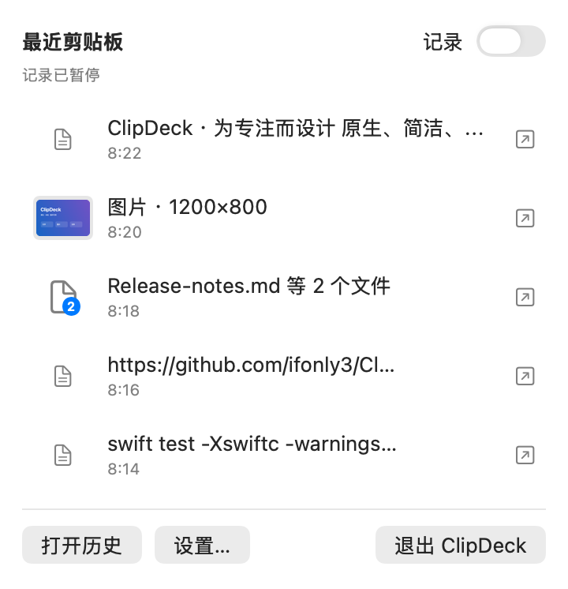
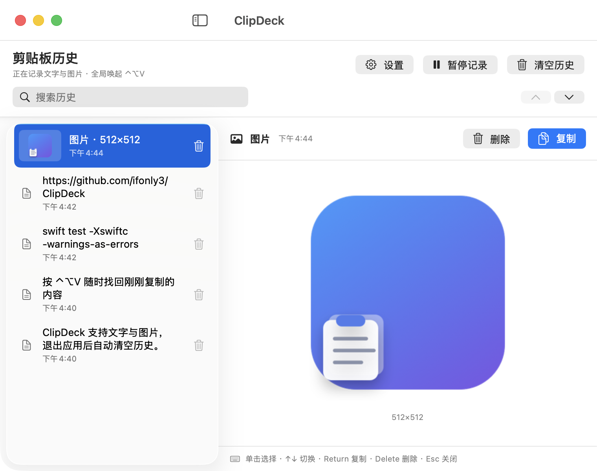
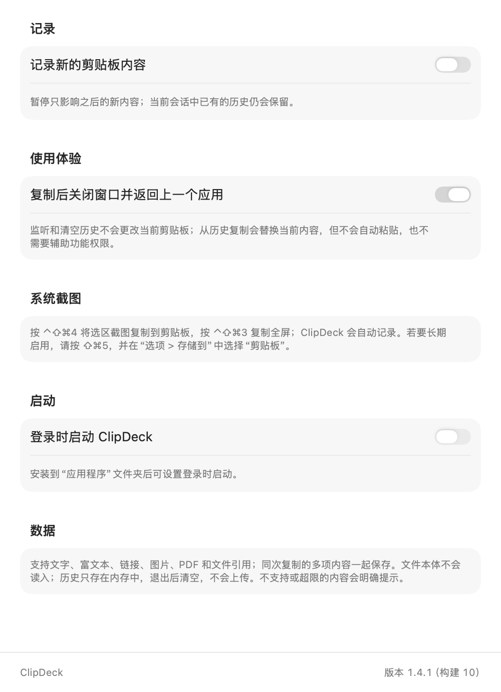

# ClipDeck

<p align="right"><strong>简体中文</strong> · <a href="README.en.md">English</a></p>

> macOS 原生、简洁、高效的会话级剪贴板历史工具。

  [](https://github.com/ifonly3/ClipDeck/actions/workflows/ci.yml) 

ClipDeck 是一款 **macOS 原生、简洁、高效** 的剪贴板历史小程序。它使用 SwiftUI 与 AppKit 构建，没有 Electron、没有第三方运行时依赖，专注于快速找回刚刚复制过的文字、图片以及 Finder 文件引用。

<p align="center">
  
</p>

<p align="center">
  <strong>复制 → ⌃⌥V → 单击或 ↑ / ↓ → Return</strong><br>
  <sub>鼠标和键盘都能完成选择；复制后可自动回到之前的应用。</sub>
</p>

## 为什么选择 ClipDeck

- **原生轻量**：SwiftUI + AppKit，空闲时几乎不占用 CPU。
- **文字、富文本与链接**：保留空格和换行，以及可用的 RTF、RTFD、HTML 和 URL 格式；也可选择“复制为纯文本”。
- **图片与 PDF**：支持 PNG、JPEG、HEIC、GIF、TIFF 等常见图片；PDF 保留原始多页数据，预览第一页。
- **一次复制，一条历史**：同次复制的多个项目按原顺序成组保存和恢复，不再拆成无法完整恢复的独立条目。
- **Finder 文件与文件夹**：多选内容作为一条历史记录保存；ClipDeck 只保留引用，不读取或复制文件本体。
- **鼠标与键盘都顺手**：按 `⌃⌥V` 随时唤起（可在设置中更换，再按一次即可关闭），单击选择、双击直接复制，也可使用 `↑` / `↓` 选择并按 `Return` 复制。
- **菜单栏常驻**：显示最近八条内容；单击恢复，右侧详情按钮直接打开对应条目。
- **会话级隐私**：历史只保存在内存中，退出 ClipDeck 后自动清空，不写入磁盘、不上传；密码管理器等标记为机密或临时的内容不会记录，也可以按应用忽略。
- **行为可控**：支持暂停记录、搜索、单条删除与撤销、清空确认、复制后返回原应用。
- **系统级启动（可选）**：默认不在登录时启动；开启后使用 macOS 原生登录项，不依赖常驻 LaunchAgent。
- **中英双语**：界面支持简体中文与 English，并自动跟随 macOS 系统语言。

## 界面一览

<p align="center">
  
</p>

<table>
  <tr>
    <td width="60%" valign="top">
      
      <br><sub><strong>图片历史</strong>：识别常见图片格式，并在详情区展示预览与尺寸。</sub>
    </td>
    <td width="40%" valign="top">
      
      <br><sub><strong>原生设置</strong>：控制记录、全局快捷键、复制后关闭、登录时启动和隐私。</sub>
    </td>
  </tr>
</table>

## 常见使用场景

| 场景 | 你刚刚复制过的内容 | ClipDeck 能做什么 |
| --- | --- | --- |
| 开发调试 | 命令、报错、代码片段、配置值 | 不必反复切回终端或文档，唤起后直接选中再粘贴。 |
| 写作整理 | 标题、链接、引用、几段候选文案 | 保留最近上下文，随时找回前一版表述。 |
| 图片工作 | 截图、图标、设计参考图 | 在历史里看预览和尺寸，再选择需要的图片。 |
| Finder 整理 | 文件、文件夹或一组项目 | 保留原始文件引用，稍后重新复制并粘贴到 Finder。 |
| 跨应用办公 | 浏览器中的资料、聊天内容、表格字段 | 在不同应用间连续复制，再按需要逐条取用。 |

例如，你可能先后复制了测试命令、分支名和一段配置：

```text
swift test -Xswiftc -warnings-as-errors
codex/clipboard-shortcuts
{"environment":"staging","region":"ap-east-1"}
```

按 `⌃⌥V` 后，直接单击目标条目或用方向键选择，再按 `Return`，无需重新寻找来源。

> ClipDeck 适合把最近复制的内容当作当前工作会话的短期记忆；它不是密码管理器、长期资料库或跨设备同步工具。

## 快速安装

### 官网 DMG（Apple 芯片）

[前往 ClipDeck 官网下载](https://clipdeck-macos.aild-pricing.workers.dev/)；适用于 Apple Silicon（M 系列）Mac，需要 macOS 13 或更高版本。

下载后打开 DMG，将 ClipDeck 拖入“应用程序”。当前社区构建包采用 ad-hoc 签名，未使用 Apple Developer ID 且未经 Apple 公证；首次打开若被 macOS 拦截，请按照官网的完整说明核对 SHA-256 并选择“仍要打开”。

### 从源码构建

要求：macOS 13 或更高版本，以及 Xcode Command Line Tools / Swift 6。

```bash
git clone https://github.com/ifonly3/ClipDeck.git
cd ClipDeck
./script/install_release.sh
```

脚本会构建 Release 版本、生成应用图标、进行 ad-hoc 签名和严格校验，然后安装到 `/Applications/ClipDeck.app` 并启动。

## 使用方式

1. 启动 ClipDeck 后，正常复制文字、图片或 Finder 文件。
2. 按 `⌃⌥V`，或点击菜单栏中的 ClipDeck 图标。
3. 搜索后单击目标条目，或使用方向键选择历史记录。
4. 按 `Return` 将内容复制回系统剪贴板。

主窗口快捷操作：

| 操作 | 快捷键 |
| --- | --- |
| 全局唤起 / 关闭 | `⌃⌥V`（可在设置中更换） |
| 搜索（空格分隔的多个关键词需全部匹配） | `⌘F` |
| 鼠标选择 | 单击任意历史条目 |
| 鼠标复制 | 双击任意历史条目 |
| 选择上一条 / 下一条 | `↑` / `↓` |
| 复制所选内容 | `Return` |
| 删除所选内容 | `Delete` |
| 撤销删除 | `⌘Z` |
| 关闭窗口 | `Esc` 或 `⌘W` |

设置可从主窗口顶部的齿轮按钮进入，也可通过菜单栏菜单打开。

主窗口标题旁显示当前版本，设置底部显示完整版本与构建号；两者直接读取已安装应用的信息，不会显示与运行版本不一致的固定文案。

macOS 原生截图也可以直接进入 ClipDeck：按 `⌃⇧⌘4` 复制选区截图，或按 `⌃⇧⌘3` 复制全屏。若希望以后每次都直接复制，请按 `⇧⌘5`，在“选项 > 存储到”中选择“剪贴板”。ClipDeck 只读取这张图片，不会主动截屏或修改系统截图偏好。

## 隐私与数据范围

剪贴板历史只保存在当前进程内存中。退出、注销、关机或重启后历史会清空，不会序列化到磁盘，也不会上传。清空 ClipDeck 历史不会清空当前系统剪贴板。

ClipDeck 在后台记录时只读取系统剪贴板，不会改写其中的当前内容。只有当你主动选择一条历史并执行“复制”时，系统剪贴板才会被该历史替换，以便随后粘贴；ClipDeck 不会自动执行粘贴。

ClipDeck 不会分析内容来猜测是否敏感，而是遵守 [nspasteboard.org](http://nspasteboard.org) 约定：来源应用主动标记为机密（Concealed）、临时（Transient）或自动生成（AutoGenerated）的内容——例如从 1Password、KeePassXC 复制的密码——会在读取任何数据之前直接跳过。“设置 > 隐私”中还可以按应用忽略（默认包含“密码”和“钥匙串访问”），这些应用复制的内容不会被记录；来源应用没有声明身份时，以复制时的前台应用为准。其余可读取且未超过容量限制的文字、图片和文件引用，都会按相同规则记录。文件历史只包含 URL 和名称，不读取文件内容；原文件被移动、删除或所在磁盘离线后，恢复时会明确提示且不会更改当前系统剪贴板。窗口位置、“复制后关闭”等普通设置由 macOS `UserDefaults` 持久化，其中不包含剪贴板正文、图片或文件引用。

默认保护限制：

- 最多保留 40 条历史。
- 每个文字项目最多 50,000 字节（UTF-8）；单次最多 256 个项目或文件引用。
- 单个富文本格式最多 8 MiB。
- 单张图片最多 32 MiB、16 MP，单边不超过 12,000 像素；成功记录的图片会保留或生成通用 PNG/TIFF 剪贴板表示。这些生成的通用格式可以重建：历史预算紧张时，较早的图片会先释放它们，再次复制时按需重建，因此能保留更多图片。
- 全部历史共享 128 MiB 保留数据预算，包括原始格式和派生预览；这是保守的数据预算，不是进程总内存上限。
- 删除撤销单独最多保留 20 个操作、64 MiB；超过预算会丢弃最早的撤销内容。清空历史也会移除历史删除的撤销，不能再恢复已清空内容。

能力边界：Finder 文件只保存引用，不备份文件本体；文件承诺（源应用尚未导出的临时文件）、音视频本体以及应用私有对象不保证恢复。若同时有通用文字或图片表示，会保存可读取部分并提示。HTML 详情使用本地文字预览，不执行脚本或下载外部资源；复制仍保留原始 HTML 格式。超限、解析失败或只保存了部分内容都会明确提示，不会静默改写系统剪贴板。

## 性能设计

- 以低频定时器观察系统剪贴板变化，避免忙轮询。
- 原生剪贴板访问统一在主线程执行，避免与搜索框和系统复制操作争用 AppKit 缓存；图片解码、指纹和预览生成在后台 actor 执行；用于识别重试的图片签名哈希仍在主线程（96 MiB 约 35 ms）。
- 保留原始压缩图片数据，并分别缓存 320 px 列表缩略图和最长边 960 px 的详情预览；旋转和镜像方向保持一致。
- 对连续图片复制使用有界队列，防止大图阻塞后续文字或占满内存。
- 缓存规范化后的搜索文本和菜单标题；搜索结果只在搜索词或历史变化时计算一次，并直接比较规范化后的 UTF-8 字节，40 条约 46 KB 的文字过滤一次不到 1 毫秒。
- 只有 HTML 的剪贴板内容用单遍线性算法提取文字，即使 8 MiB 的标记也不会卡住界面。

已知限制：macOS 的同步剪贴板提供者如果响应很慢，读取原始数据时仍可能短暂阻塞界面；容量限制只能在提供者返回数据后检查。后台直接读取同一 `NSPasteboard` 在并发压力测试中出现了 AppKit 缓存崩溃，因此没有将这种不安全的优化纳入发行版。

## 本地开发

Debug 构建并运行：

```bash
./script/build_and_run.sh
```

构建与测试：

```bash
swift build -Xswiftc -warnings-as-errors
swift test -Xswiftc -warnings-as-errors
```

可选调试模式：

```bash
./script/build_and_run.sh --verify
./script/build_and_run.sh --debug
./script/build_and_run.sh --logs
./script/build_and_run.sh --telemetry
```

Debug 脚本会停止已运行的 ClipDeck、构建并验证临时 `.app`，再使用普通 LaunchServices 打开它。项目明确禁止多实例；请勿使用 `open -n` 启动，否则多个应用进程的窗口可能重叠。

## 项目结构

```text
Sources/ClipDeck/
├── App/          # SwiftUI scenes 与应用入口
├── Models/       # 剪贴板内容模型
├── Services/     # 图片处理、热键、登录项与窗口协调
├── Stores/       # 剪贴板采集、历史与内存预算
├── Support/      # 通用辅助代码
└── Views/        # 主窗口、详情、菜单栏与设置界面

Tests/            # Swift Testing 回归测试
script/           # 构建、打包、签名和安装脚本
```

## 参与贡献

欢迎提交 Issue、功能建议和 Pull Request。提交代码前请运行完整测试，并尽量保持 ClipDeck 原生、克制、快速的产品方向。

## License

ClipDeck 使用 [MIT License](LICENSE) 开源。
